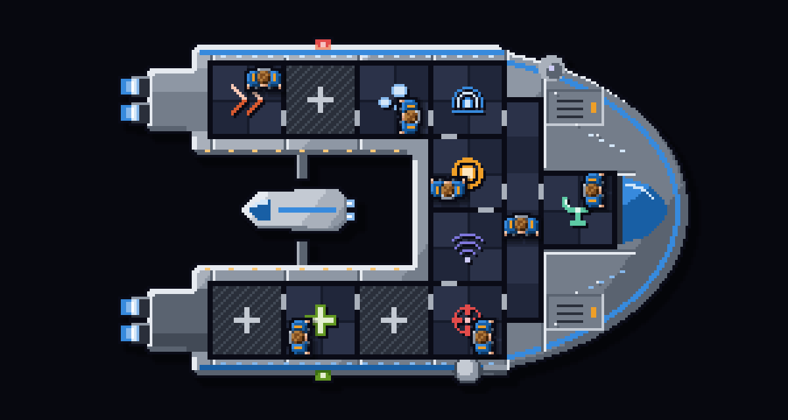

# Driftline

Raumschiff-Roguelike für Android in Draufsicht. Glaubwürdige, funktionale Raumfahrttechnik in realistischer HD-Pixel-Art.



## Stand

| Bereich | Status |
|---|---|
| Stil-Brief | [docs/art-brief.md](docs/art-brief.md) |
| Styleguide und Entscheidungen | [docs/art-styleguide.md](docs/art-styleguide.md) |
| Crew Mensch (groß 40×44, klein 16×16, je 4 Richtungen) | Stilprobe |
| Schiff Mensch-Frachter | Stilprobe – [Raumliste](docs/schiffe/mensch-frachter.md) |
| Weitere 5 Spezies, 11 Schiffe, Farbvarianten | offen |

## Ordner

```
art/
  source/   SVG-Vorlagen (crew/, ships/)
  export/1x Spielgrafiken in Originalauflösung (transparentes PNG)
  export/4x dieselben Grafiken ×4 (Nearest Neighbor)
  preview/  Vorschauen auf Weltraum-Hintergrund #07080F
  palette/  Palette als .gpl (GIMP/Aseprite), .hex und .png
docs/       Brief, Styleguide, Raumlisten der Schiffe
tools/artgen/  Python-Pipeline, die alles unter art/ erzeugt
```

## Grafiken neu erzeugen

Voraussetzungen: Python 3.10+, `rsvg-convert` (Paket `librsvg2-bin`).

```bash
pip install -r tools/artgen/requirements.txt
python3 tools/artgen/build.py
```

Der Ordner `art/` wird dabei vollständig neu geschrieben. Änderungen also im Code unter `tools/artgen/` machen, nicht in den PNGs.
