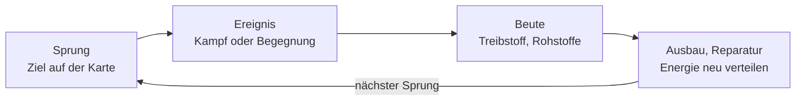

# Hullbound – Game-Design-Dokument

Stand: 26.11.2026 · Autor: Filip Kroczak · Online-Fassung: [Claude Doc](https://claude.ai/artifact/FhYZsfLYM6pFQa2jdF4vUp)

## Vision und Eckdaten

Hullbound ist ein Raumschiff-Roguelike für Android in realistischer Pixel-Art: Du führst ein kleines Schiff samt Crew durch prozedural erzeugte Universen, kämpfst, handelst, reparierst und baust aus. Inspiration ist FTL, umgesetzt für Touch und kurze Sessions. Der Titel ist „Hullbound“; früherer Arbeitstitel war „Driftline“.

**Einflüsse:** Star Wars und Star Trek als Stimmung, nicht als Vorlage.

- **Star Wars:** raue Grenzwelten, Schmuggler, Kopfgelder, schnelle Raumkämpfe, ein Imperium-gegen-Rebellen-Konflikt
- **Star Trek:** Erkundung unbekannter Welten, Außenteams, Erstkontakt, moralische Entscheidungen, Diplomatie statt immer Waffen

**Spielprinzip:** Nur der Raumkampf läuft grafisch in Echtzeit. Alles andere ist textbasiert: Ereignisse, Händler, Wracks und Planetenerkundung laufen über Dialogboxen mit Auswahloptionen.

| Eckpunkt | Entscheidung |
| --- | --- |
| Plattform | Android (Querformat), später optional iOS und PC |
| Engine | Godot 4 |
| Stil | realistische HD-Pixel-Art, Palette mit ca. 64 Farben |
| Session-Länge | 5–15 Minuten pro Sektor, Run 45–90 Minuten |
| Zielgruppe | Fans von FTL, Roguelikes und Taktik auf dem Handy |
| Monetarisierung | Einmalkauf (ca. 4,99 €), kostenlose Demo mit dem ersten Universum, keine Werbung |
| Rechtliches | Mechaniken frei nutzbar; keine Namen, Grafiken, Texte, Schiffe oder Begriffe aus FTL, Star Wars oder Star Trek |

## Kernschleife und Kampf

Jeder Sprung führt zu einem Ereignis, das Beute oder Schaden bringt; zwischen den Sprüngen wird das Schiff repariert und ausgebaut.

Im Jagd-Modus rückt mit jedem Durchlauf die Jägerfront vor; nach 10 Sprüngen hat sie den Ausgang erreicht. Ausbau und Reparatur entscheiden, ob das Schiff den Boss übersteht.

**Sprung:** Das Schiff bleibt immer im Bild, auch zwischen den Kämpfen. Nach jedem Sprung lädt der Sprungantrieb neu (außerhalb des Kampfs schnell, im Kampf nur mit Energie im Antrieb). Ist er voll, öffnet der Sprungknopf die Karte; der Sprung selbst zeigt eine Warpblase und Lichtstreifen.

**Kampf: Echtzeit mit Auto-Pause.** Das Spiel hält an, sobald du einen Raum, eine Waffe oder ein Crewmitglied antippst, und läuft weiter, wenn du den Befehl bestätigst. Eine Pausentaste ist jederzeit erreichbar.

- Waffen laden in Echtzeit, du wählst Ziel-Raum am Gegnerschiff
- Schilde blocken Treffer, bis sie überladen sind
- Treffer kosten immer Hülle; Raumschaden, Brände und Hüllenbrüche hängen mit eigener Chance an der Waffe (Schwerlaser knacken Systeme, Pulslaser kratzen meist nur an der Hülle), dazu Verletzte im Raum
- Ausweichen hängt von Antrieb und besetztem Cockpit ab

**Steuerung im Querformat:** links das eigene Schiff, rechts das Gegnerschiff, unten drei große Daumen-Buttons (Pause, Waffen, Sprung). Crew bewegst du per Tippen auf Figur und Zielraum, nicht per Ziehen. Räume sind mindestens 48 dp groß, damit sie sicher treffbar sind.

## Schiff, Crew, Ausbau und Reparatur

Das Schiff besteht aus Räumen, jeder Raum trägt ein System; der Reaktor liefert eine begrenzte Zahl Energiebalken, die du auf die Systeme verteilst.

| System | Wirkung | Upgrade-Effekt |
| --- | --- | --- |
| Reaktor | Energie für alle Systeme | mehr Energiebalken |
| Schilde | blocken Treffer | zusätzliche Schildschicht |
| Waffen | Laser, Raketen, Ionen, Drohnen | mehr Waffenslots |
| Antrieb | Ausweichen, Sprung laden | schneller, höhere Ausweichrate |
| Cockpit | Voraussetzung für Ausweichen | Bonus durch erfahrene Crew |
| Medbay | heilt Crew im Raum | schnellere Heilung |
| Sensoren | zeigen Gegner-Innenleben und Kartendetails | mehr Infos auf der Sprungkarte |

### Energiemanagement

Energie ist die zentrale Entscheidung im Schiff: Der Reaktor liefert nie genug für alle Systeme gleichzeitig.

- Jedes System hat Stufen (Balken), jeder Balken braucht eine Energieeinheit
- Umschichten kostet eine kurze Ladezeit, z. B. Schilde runter und Waffen hoch für eine Salve
- Beschädigte Systeme verlieren Balken, bis sie repariert sind
- Reaktortreffer senken die Gesamtenergie; Notstrom hält Lebenserhaltung und Schilde kurz am Laufen
- Außerhalb des Kampfes fließt Energie in Sensoren (mehr Karteninfo), Medbay oder Sprungantrieb
- Der Reaktor ist das teuerste, aber wichtigste Upgrade

### Sauerstoff, Türen und Luftschleusen

Sauerstoff ist eine eigene Ressource pro Raum; die Lebenserhaltung füllt ihn nach, wenn sie Energie bekommt.

- Jeder Raum hat einen Sauerstoffwert; Hüllenbrüche lassen ihn entweichen, ohne Sauerstoff verliert Crew Lebenspunkte
- Türen sind ein eigenes System: geschlossen bremsen sie Feuer und Enterer, aufgerüstet halten sie länger
- Luftschleusen öffnen gezielt Räume ins All: ersticken Brände und schwächen Enterkommandos, gefährden aber eigene Crew
- Eine Schleuse saugt zuerst ihren eigenen Raum leer, über offene Türen auch die Nachbarräume; wer Türen schließt, begrenzt den Sog
- Jedes Schiffslayout hat mindestens eine Schleuse in einem Außenraum (Feld `airlocks` in `game/data/ships/*.json`)
- Androiden und Petrani brauchen keinen Sauerstoff und sind damit ideale Verteidiger in gefluteten Räumen

### Entern (Konzept, Stand 26.11.2026)

Crew kämpft Raum gegen Raum, auf dem eigenen Schiff gegen Enterkommandos und per Teleporter auf dem Gegnerschiff. Ziel: Die Kampfstärke der Spezies zählt, und ein Gegner lässt sich kapern statt nur zerstören. Alle Zahlen sind Startwerte für das Balancing.

**Nahkampf im Raum**

- Neuer Wert `melee` je Spezies (in `data/species.json`), abgeleitet aus der Spalte „Kampf“: Schaden je Sekunde = 2 × Kampfwert. Mensch, Androide und Petrani 3 (6 LP/s), Kith’ra und Ormok 5 (10 LP/s), Veyari 1 (2 LP/s)
- Charakterzüge wirken direkt: Mutig +1, Hitzkopf +2, Ängstlich −1 Kampf
- Sind Feinde im selben Raum, kämpfen alle automatisch; jede Figur greift eine Gegnerfigur an, bevorzugt die schwächste. Wer kämpft, repariert, löscht und bedient keine Konsole
- Richtwert: zwei Menschen gegen zwei Menschen dauert etwa 15 Sekunden; ein Ormok hält zwei Menschen etwa 25 Sekunden stand
- Feuer und Sauerstoffmangel treffen beide Seiten gleich; Spezies ohne Luftbedarf und feuerfeste Spezies sind hier im Vorteil
- Verletzte ziehen sich nicht von selbst zurück; der Spieler schickt sie in die Medbay

**Gegner-Enterkommandos (zuerst bauen)**

- Gegner mit Teleporter beamen 2 Crew (später 3) in einen Raum mit System, bevorzugt Waffen, Schilde oder Reaktor
- Vorwarnung: Der Zielraum blinkt 2 Sekunden lang rot, die Auto-Pause greift. So bleibt Zeit, Türen zu schließen oder Crew zu schicken, auch auf dem Handy
- Enterer in einem Raum ohne Verteidiger beschädigen das System (eine Stufe je 4 Sekunden) und ziehen dann zum nächsten Systemraum weiter
- Geschlossene Türen müssen sie aufbrechen (Tür-Stufe 1: 4 s, 2: 8 s, 3: 12 s)
- Abwehr: eigene Crew, Türen, Luftschleuse (Raum leeren, Enterer verlieren Luft), später Abwehrbots
- Der Teleporter des Gegners ist ein eigener Raum: Wird er getroffen, bleiben weitere Enterkommandos aus
- Welche Gegner entern: Plünderer ab Stufe 6, Schwerer Kutter ab Stufe 10, Bosse ab Sektor 2. Gegnerschiffe bekommen dafür Lebenserhaltung und benannte Crew mit Spezies

**Eigener Teleporter (erst Mitte bis Ende des Runs)**

Teleporter und Kaperung gehören zum ausgebauten Schiff, nicht zum Start: Am Anfang fehlen Reaktor, Erweiterungsraum und Crew dafür. Der Spieler soll sich erst gegen Enterkommandos verteidigen lernen und später selbst entern.

- Freischaltung im Run: Händler bieten den Teleporter erst ab Sektor 2 an (Jagd und Endlos), selten auch als Beute aus Aufträgen ab Sektor 2. In der Startauswahl ist er nicht wählbar
- Voraussetzungen zum Einbau: ein freier Erweiterungsraum und Reaktor mindestens 10 (Start: 8); ohne Ausbau lässt er sich also nicht betreiben
- Preis beim Händler ca. 50 Rohstoffe; Stufe 2 und 3 als Upgrade in der Werft bzw. beim Schiffsausbau
- Kith’ra-Kaperschiff: startet nicht mit Teleporter, sondern mit vorbereitetem Teleporterraum; dort kostet der Teleporter die Hälfte und braucht nur Reaktor 9, ist aber ebenfalls erst ab Sektor 2 zu haben
- Modul Stufe 1–3, je Stufe 1 Energie
- Kapazität 2 / 3 / 4 Personen, Aufladezeit 20 / 15 / 10 Sekunden
- Bedienung: Knopf TELEPORTER unten rechts, dann Crew im Teleporterraum wählen, dann einen Raum am Gegnerschiff antippen (Auto-Pause wie beim Zielen der Waffen)
- ZURÜCKBEAMEN holt alle auf einmal zurück, sobald der Teleporter geladen ist, egal wo sie stehen
- Crew auf dem Gegnerschiff erscheint in der Crew-Liste mit Markierung. Fällt dort die Luft weg, nimmt sie Schaden wie auf dem eigenen Schiff
- Risiko: Wird das Gegnerschiff zerstört, während eigene Crew drüben ist, stirbt sie. Ab 25 % Gegnerhülle warnt die Infozeile

**Kaperung statt Zerstörung**

- Ist die gesamte Gegner-Crew tot, ist das Schiff gekapert: Der Kampf endet, Beute +50 % Rohstoffe, 50 % Chance auf eine Waffe des Gegners (ohne freien Platz ins Lager), Treibstoff aus den Tanks
- Gekaperte Schiffe fliehen nicht mehr; eine fliehende Gegner-Crew lässt sich also durch Entern aufhalten
- Jäger-Fregatte und Bosse haben eine Selbstzerstörung: Sobald ihre Crew fällt, explodiert das Schiff nach 10 Sekunden. Rechtzeitig zurückbeamen

**Umsetzung in Schritten**

1. `melee` je Spezies, Raumkampf und Tür-Aufbrechen auf dem eigenen Schiff
2. Gegner-Enterkommandos mit Vorwarnung, Lebenserhaltung und Crew für Gegnerschiffe
3. Eigener Teleporter als Modul (Händler ab Sektor 2, Reaktor ≥ 10), Zurückbeamen, Warnung bei niedriger Gegnerhülle
4. Kaperung mit Beute, Selbstzerstörung bei Jägern und Bossen
5. Tutorial-Hinweis und Lexikon-Eintrag; danach Abwehrbots (Droiden-Bay)

**Munition (Vorschlag):** Raketen und Drohnenteile als zusätzliche Verbrauchsgüter für starke Waffen und Drohnen; sie werden wie Treibstoff bei Händlern und aus Wracks erworben.

**Permadeath:** Kein manuelles Speichern und kein Neuladen. Wird das Schiff zerstört oder stirbt die gesamte Crew, endet der Run; der Autosave nach jedem Sprung dient nur zum Fortsetzen nach einer Unterbrechung.

**Ressourcen:** Treibstoff ist zugleich Währung und Sprungkosten: Jeder Sprung kostet 1 Treibstoff, und Händler nehmen Treibstoff als Bezahlung. Wer zu viel ausgibt, strandet. Rohstoffe werden für Upgrades und sofortige Reparaturen gebraucht. Bei 0 Treibstoff bleibt nur ein Notsignal, das ein zufälliges Ereignis auslöst, oft Piraten oder Jäger.

**Wracks:** Jedes zerstörte Schiff kann untersucht werden und liefert eine zufällige Menge Treibstoff und Rohstoffe, abhängig vom Schiffstyp. Ein Außenteam an Bord des Wracks findet mehr, kann aber auf Fallen, Lecks oder Überlebende stoßen.

**Reparatur, zwei Wege:**

- Crew im beschädigten Raum repariert über Zeit, kostenlos, aber die Person fehlt an ihrem Posten
- Reparaturkit oder Werft: sofort, kostet Rohstoffe; die Hülle lässt sich nur so reparieren

**Kein Automatismus nach dem Kampf:** Nach einem Sieg läuft die Zeit an Bord weiter, bis der Spieler zur Karte wechselt. Wer sich nicht um das Schiff kümmert, nimmt die Schäden mit: Systeme bleiben beschädigt, Lecks offen, verletzte Crew verletzt, und Brände breiten sich in andere Räume aus. Auch während eines Sprungs vergehen einige Sekunden an Bord. Erst die Reparaturstation setzt alles gegen Rohstoffe instand. Später übernehmen Reparaturbots einen Teil der Arbeit (siehe Droiden-Bay).

**Droiden-Bay (später, nur mit ausgebautem Schiff):** Ein eigener Raum für bis zu 4 Bots, der nicht zur Grundausstattung gehört. Freigeschaltet wird er erst über Upgrades (Erweiterungsraum plus Reaktorleistung), etwa ab der Mitte eines Runs oder auf weiter ausgebauten Schiffen.

- **Reparaturbots:** fliegen selbstständig in beschädigte Räume, löschen kleine Brände, flicken Lecks und reparieren Systeme, langsamer als Crew
- **Abwehrbots:** verteidigen das Schiff gegen Enterkommandos, die sich herüberteleportieren, und halten Eindringlinge in Schach, bis die Crew da ist
- **Belegung frei wählbar:** z. B. 4 Reparaturbots oder 2 Reparatur- und 2 Abwehrbots; jeder Bot braucht Energie aus der Droiden-Bay, zerstörte Bots werden beim Händler ersetzt (Drohnenteile)
- **Reihenfolge im Spiel:** zuerst müssen Enterkommandos existieren, damit Abwehrbots einen Zweck haben

**Crew:** benannte Figuren aus 6 Spezies mit je einer Stärke (z. B. schneller reparieren, feuerfest, stark im Nahkampf, Bonus an Systemen). Crew sammelt Erfahrung pro System und kann sterben; neue Crew kommt über Ereignisse und Stationen.

### Spezies

Sechs spielbare Spezies, jede mit klarer Stärke, klarer Schwäche und eigenen Antwortoptionen in Text-Ereignissen. Die Namen sind Arbeitstitel.

| Spezies | Stärke | Schwäche | Eigene Text-Optionen |
| --- | --- | --- | --- |
| Menschen | Allrounder, lernen Systeme schneller | keine besondere Stärke im Kampf | Verhandeln, Handel |
| Kith’ra (Insektoid, Gottesanbeter- oder Kakerlaken-Typ) | stark im Nahkampf, überstehen Feuer, Strahlung und kurz Vakuum | bedienen Systeme langsamer, wirken auf andere bedrohlich | Einschüchtern, Tunnel und Wracks durchsuchen |
| Androiden | brauchen keinen Sauerstoff, werden repariert statt geheilt | anfällig für Ionenwaffen, teuer in der Anschaffung | Daten auslesen, Technik hacken |
| Veyari (hochintelligent, körperlich schwach) | Bonus an Waffen, Sensoren und Reaktor, schnellere Ladezeiten | wenig Lebenspunkte, schwach im Nahkampf | Wissenschaft, Anomalien deuten |
| Ormok (groß, sehr kräftig, einfach gestrickt) | sehr viele Lebenspunkte, stärkster Nahkämpfer | reparieren und bedienen Systeme schlecht | rohe Gewalt, oft mit lustigen Folgen |
| Petrani (siliziumbasiert) | brauchen keine Lebenserhaltung, überstehen Vakuum, Feuer und giftige Atmosphären | sehr langsam, heilen nicht in der Medbay, sondern nur durch Rohstoffe | lebensfeindliche Planeten betreten, Kristall- und Gesteinswesen verstehen |

### Individuelle Crew

Jedes Crewmitglied basiert auf dem Grundsprite seiner Spezies, ist aber ein Individuum mit eigenem Aussehen, eigener Persönlichkeit und eigenen Werten.

- **Aussehen:** gleiche Silhouette pro Spezies, dazu Varianten bei Farbe (Haut, Chitin, Metall, Gestein), Kopfdetails (Frisur, Fühler, Kristallform), Markierungen (Narben, Muster, Lackierung) und Ausrüstung
- **Werte:** Spezies-Basiswerte plus persönliche Abweichung (Lebenspunkte ±10 %, ein Wert +1, ein Wert −1)
- **Persönlichkeit:** 1–2 Charakterzüge, die Werte verändern und eigene Antworten in Text-Ereignissen freischalten

**Basiswerte je Spezies (Entwurf, Skala 1–5):**

| Spezies | Lebenspunkte | Tempo | Reparatur | Kampf | Systembonus |
| --- | --- | --- | --- | --- | --- |
| Mensch | 100 | 3 | 3 | 3 | lernt alle Systeme schneller |
| Kith’ra | 110 | 3 | 2 | 5 | keiner |
| Androide | 100 | 3 | 4 | 3 | Schilde |
| Veyari | 70 | 3 | 3 | 1 | Waffen, Sensoren, Reaktor |
| Ormok | 160 | 2 | 1 | 5 | keiner |
| Petrani | 140 | 1 | 3 | 3 | Reaktor |

Im Prototyp umgesetzt (`game/data/species.json`): Lebenspunkte, Lauftempo, Reparaturtempo, Konsolenboni, Feuer- und Luftbedarf und Medbay-Heilung je Spezies; die Crew-Karte im Spiel zeigt sie an. Der Captain ist markiert. Kampfwerte folgen mit dem Entern.

**Charakterzüge (Auswahl):**

| Zug | Wirkung |
| --- | --- |
| Mutig | +1 Kampf, flieht nie aus brennenden Räumen |
| Ängstlich | −1 Kampf, +5 % Ausweichen als Pilot |
| Tüftler | +1 Reparatur, repariert Systeme über Stufe 1 hinaus kurzzeitig |
| Hitzkopf | +2 Kampf, provoziert in Ereignissen Konflikte |
| Gierig | mehr Treibstoff aus Wracks, wählt in Ereignissen riskante Optionen |
| Neugierig | zusätzliche Optionen auf Planeten, höheres Risiko für das Außenteam |
| Loyal | bleibt bei Meuterei-Ereignissen treu, Bonus neben dem Captain |
| Stoisch | Moral sinkt nicht, wenn Crew stirbt |

Beispiel: *Brakka*, Ormok, Hitzkopf und Loyal: 168 Lebenspunkte, Kampf 5 (+2 im Hitzkopf-Modus), Reparatur 1. Im Text-Ereignis: „Brakka will die Tür nicht öffnen. Brakka will sie einschlagen.“

### Schiffsstile pro Spezies

Jede Spezies hat zwei Schiffsstile mit eigener Optik, Raumaufteilung und Spielweise; zusammen 12 spielbare Schiffe. Zu Beginn ist nur der Menschen-Frachter frei, die übrigen werden über Erfolge freigeschaltet.

| Spezies | Optik | Typ A | Typ B |
| --- | --- | --- | --- |
| Mensch | zweckmäßig, grau-blau, Nieten und Paneele | Frachter: ausgewogen, großer Laderaum, leicht zu lernen | Flottenkreuzer: mehr Waffenslots, starke Schilde, kleinere Crew |
| Kith’ra | organischer Chitinpanzer, grün, Waben | Schwarmschiff: startet mit Kampfdrohnen | Kaperschiff: auf Entern ausgelegt (Teleporter ab Sektor 2 günstiger), schwache Waffen |
| Androide | geometrisch, weiße Module, Leuchtlinien | Modulwürfel: Reparaturdrohne, Räume umbaubar | Ionenjäger: Ionenwaffen, Hacking-System |
| Veyari | elegant, violett, geschwungene Linien | Forschungsschiff: starke Sensoren und Schilde, dünne Hülle | Lanzenschiff: Strahlenwaffe mit großer Reichweite, fragil |
| Ormok | grob verschweißt, Rost, Schrottplatten | Schrottkoloss: sehr viel Hülle, Panzerung, langsam | Rammbock: Rammsporn als Waffe, starke Front, wenig Systeme |
| Petrani | ausgehöhlter Asteroid mit Kristallen | Asteroidenschiff: Hülle regeneriert langsam, keine Lebenserhaltung nötig | Kristallresonator: Kristallwaffen laden aus überschüssiger Reaktorenergie |

### Raumlayouts und Erweiterungsräume

Jeder Schiffsstil hat ein eigenes Raumlayout und 1–3 leere Erweiterungsräume, die im Lauf eines Runs mit Modulen belegt werden. Manche Schiffe starten mit einem bereits belegten Erweiterungsraum.

- Module kauft man bei Händlern oder Werften gegen Treibstoff und Rohstoffe, oder findet sie in Wracks und auf Planeten
- Jedes Modul braucht Energie und konkurriert damit um den Reaktor
- Ein Modul lässt sich tauschen, aber nicht doppelt einbauen; leere Räume sind grau und begehbar

| Schiff | Erweiterungsräume | Start-Belegung |
| --- | --- | --- |
| Mensch Frachter | 3 | keine |
| Mensch Flottenkreuzer | 2 | keine |
| Kith’ra Schwarmschiff | 2 | Drohnensteuerung |
| Kith’ra Kaperschiff | 2 | Teleporter |
| Androide Modulwürfel | 3 | keine |
| Androide Ionenjäger | 2 | Hacking |
| Veyari Forschungsschiff | 2 | Labor |
| Veyari Lanzenschiff | 1 | keine |
| Ormok Schrottkoloss | 3 | keine |
| Ormok Rammbock | 1 | keine |
| Petrani Asteroidenschiff | 2 | Raffinerie |
| Petrani Kristallresonator | 1 | keine |

**Module (Entwurf):**

| Modul | Wirkung |
| --- | --- |
| Teleporter | Crew aufs Gegnerschiff beamen (Entern) oder in Wracks schicken |
| Kryokapseln | zusätzliche Crew eingefroren lagern, bei Bedarf auftauen |
| Hacking | Drohne legt ein Gegnersystem zeitweise lahm |
| Drohnensteuerung | Kampf-, Abwehr- oder Reparaturdrohnen einsetzen |
| Droiden-Bay | bis zu 4 Bots an Bord: Reparaturbots und Abwehrbots gegen Enterer (erst mit ausgebautem Schiff) |
| Tarnung | kurz unsichtbar: Gegner trifft nicht, eigene Waffen laden weiter |
| Labor | Anomalien und Fundstücke analysieren, zusätzliche Optionen in Ereignissen |
| Klonbank | gefallene Crew gegen Rohstoffe wiederherstellen, mit Erfahrungsverlust |
| Traktorstrahl | Wracks ohne Außenteam bergen, fliehende Gegner festhalten |
| Raffinerie | Rohstoffe in Treibstoff umwandeln |
| Frachtraum | mehr Lagerplatz, bessere Preise beim Handel |

## Spielmodi

Beide Modi nutzen dieselben Bausteine; der Jagd-Modus wird zuerst gebaut, weil er begrenzt und gut testbar ist.

### Die Jagd

Pro Universum gibt es 20–25 Sprungziele, aber nur 10 Sprünge, bevor die Jägerflotte dich einholt.

- Der Ausgang zum nächsten Universum ist von Anfang an auf der Karte sichtbar; der Weg dorthin muss geplant werden
- Die Front der Jäger rückt auf der Karte sichtbar von links vor (je Sprung ein Zehntel der Karte)
- Springen kann man, solange Treibstoff da ist; jedes System hinter der Front ist von Jägern besetzt und bedeutet einen harten Kampf (Händler und Ereignisse dort sind weg)
- Nach Sprung 10 kein sofortiges Game Over: Jeder weitere Sprung landet hinter der Front, die Jäger werden je Sprung stärker
- Am Ausgang wartet der Endboss des Universums; nach dem Sieg folgt der FTL-Sprung ins nächste Universum
- Jedes Universum ist schwerer und hat einen eigenen Boss und eine eigene Gegnerfraktion
- Ziel: 4–5 Universen bis zum finalen Boss (Prototyp: 4)

### Endloses Universum

Sektoren ohne Ende, die mit jeder Stufe schwerer werden; ohne Verfolger, aber mit Fraktionen, die sich an dein Verhalten erinnern. Im Prototyp gibt es schon die Sektoren mit steigender Schwierigkeit und den Rekord (erreichter Sektor), Fraktionen folgen.

- Hilfst du einer Fraktion, wird sie Verbündeter: bessere Preise, Hilfe im Kampf, sichere Systeme
- Greifst du sie an, wird sie feindlich und schickt Kopfgeldjäger
- Motivation: Highscore (erreichter Sektor, Punkte) und Story-Fragmente, die nach und nach die Welt erklären

## Planeten erkunden

Planeten sind kleine Roguelike-Quests in Textform: Ein Außenteam aus 1–3 Crewmitgliedern landet und durchläuft eine Kette von 3–6 Entscheidungen.

1. Planet scannen: Die Sensorstufe bestimmt, wie viel man vorher weiß (Klima, Lebenszeichen, Gefahr)
2. Außenteam wählen: Spezies und Fähigkeiten schalten zusätzliche Antwortoptionen frei
3. Textszenen mit Entscheidungen: erkunden, verhandeln, kämpfen, fliehen
4. Ergebnis: Treibstoff, Rohstoffe, neue Crew, Technik, Ansehen bei Fraktionen, oder Verletzte und Verluste

- **Planetentypen (Entwurf):** Wüstenwelt mit Schmugglern, Dschungel mit Ruinen, Eiswelt mit Forschungsstation, Gasriese mit Schürfplattform, Anomalie-Welt
- **Roguelike-Element:** Szenen werden zufällig aus Bausteinen zusammengesetzt; Folgen wirken über mehrere Sprünge nach, z. B. taucht ein geretteter Gefangener später als Verbündeter auf
- **Im Jagd-Modus (Vorschlag):** Eine Landung kostet keinen Treibstoff, aber Zeit; jede zweite Landung rückt die Jäger um einen Sprung vor

## Meta-Fortschritt, Fraktionen und Ereignisse

Zwischen den Runs bleibt nur Auswahl erhalten, keine Stärke: Jeder Run startet fair.

- **Freischaltbar:** neue Schiffe (je eigene Raumaufteilung und Startwaffen), Startcrews, alternative Schiffslayouts
- **Nicht dauerhaft:** Werte-Boni, Startressourcen, Upgrades

**Ereignistypen auf der Sprungkarte:**

| Typ | Was passiert |
| --- | --- |
| Kampf | Gegnerschiff greift an oder wird angegriffen |
| Wrack | zerstörtes Schiff untersuchen: zufällig Treibstoff und Rohstoffe |
| Planet | Außenteam-Quest in Textform |
| Händler | Waffen, Crew, Rohstoffe, Reparatur gegen Treibstoff |
| Erstkontakt | unbekannte Spezies: Diplomatie, Handel oder Konflikt |
| Notruf | Textentscheidung mit Risiko und Belohnung |
| Anomalie | Nebel, Sonnensturm, Asteroiden verändern den Kampf |
| Fraktions-Ereignis | beeinflusst das Ansehen bei einer Fraktion |
| Leer | nichts, aber sicher |

**Fraktionen (Entwurf):** Händlergilde, Piratenclans, eine Maschinen-Spezies, die Jägerflotte als Gegenspieler. Namen und Hintergrund folgen.

## Art-Direction und UI

Realistische Pixel-Art in hoher Auflösung: echte Proportionen, Materialien und Licht, umgesetzt als Pixelgrafik mit begrenzter Palette (ca. 64 Farben) und dunklen Konturen. Schiffe folgen einem funktionalen, glaubwürdigen Raumfahrt-Design mit Fensterreihen, Positionslichtern und Plattenfugen; neben klassischen Rumpfformen gibt es auch C- und 7-förmige Schiffe.

- **Schiffe:** Draufsicht, Räume klar farbcodiert nach System; Spielerschiffe eher rundlich und warm, Jägerflotte kantig und rot
- **Crew:** Pixel-Figuren in Draufsicht (passend zur Schiffsansicht), Spezies an Silhouette und Farbe von oben erkennbar
- **Effekte:** Feuer, Funken, Schildblitze als kurze Pixel-Animationen
- **UI:** Statusleiste oben (Hülle, Energie, Sprungzähler), drei Daumen-Buttons unten, Textereignisse als Pixel-Dialogbox mit kleiner Szenen-Illustration (Planet, Wrack, Station)
- **Grafik-Quellen:** eigene Pipeline (`tools/artgen`, feste Palette) und Fable-Prompt; ein Artist höchstens für Bosse, Porträts und Store-Grafik kurz vor dem Release
- **Musik:** Chiptune, ruhig auf der Karte, treibend im Kampf

### Bildschirme (Querformat, Touch)

Mockups: [Sprungkarte](../art/pixel/sprungkarte_pixel.png), [Kampf-HUD](../art/pixel/hud_kampf_pixel.png), [Ereignis-Dialog](../art/pixel/hud_ereignis_pixel.png)

**Sprungkarte:** Nebel-Hintergrund, Sprungziele als Punkte mit gestrichelten Verbindungen. Besuchte Ziele grün, erreichbare gelb, unbekannte weiß. Markierungen für Notruf, Händler, Boss und Ausgang; die Jägerfront rückt als rote Fläche von links vor. Antippen zeigt ein Infofeld mit Treibstoffkosten, zweites Antippen springt.

**Kampf-HUD:**

- Oben links: Hülle, Schilde, Sauerstoff und Ausweichchance
- Oben Mitte: Treibstoff, Rohstoffe, Raketen, Drohnenteile
- Oben rechts: Sprung-Button mit Ladebalken, Karte, Pause
- Links: Crew-Liste mit Lebenspunkten; Antippen wählt die Figur
- Unten links: Reaktorbalken und Energiesäulen pro System; Antippen einer Säule gibt oder nimmt Energie
- Unten Mitte: Waffen mit Ladebalken; Waffe antippen, dann Zielraum am Gegner antippen
- Unten rechts: Drohnen, Türen (alle schließen) und Luftschleuse

**Ereignis-Dialog:** pausiert das Spiel, links eine kleine Szenen-Illustration, rechts der Text, darunter die Optionen als große Touch-Flächen. Optionen, die eine Spezies oder ein Modul freischaltet, sind farbig markiert, z. B. „[Veyari] Signal aus dem Orbit analysieren“.

Arbeitsweise für Grafiken und Prompt für die Erstellung: siehe [art/README.md](../art/README.md) und [docs/fable-prompt.md](fable-prompt.md).

## Technik und Roadmap

Godot 4 mit GDScript, Export als Android-App (AAB für den Play Store); alle Inhalte liegen als Daten vor, nicht im Code.

- **Datengetrieben:** Waffen, Systeme, Gegner, Ereignisse und Fraktionen als Godot-Resources oder JSON, damit Inhalte und Balancing ohne Codeänderung möglich sind
- **Prozedurale Karte:** pro Universum ein Seed; 20–25 frei verteilte Knoten, kreuzungsfreie Verbindungen in beide Richtungen, garantierter Weg zum Ausgang (5–8 Sprünge)
- **Speichern:** automatisch nach jedem Sprung, ein Run-Slot pro Modus
- **Zielgeräte:** ab Android 8, Mittelklasse-Handys mit 60 fps

| Phase | Inhalt | Meilenstein danach |
| --- | --- | --- |
| 1: Prototyp (4–6 Wochen) | Kampf mit einem Schiff, Energie, Brände, Sauerstoff und Luftschleusen | Kampf macht auf dem Handy Spaß |
| 2: Ein Run | Sprungkarte, Events, Händler, Upgrades, Jagd-Modus mit Boss | Run komplett spielbar |
| 3: Inhalte | Waffen, Gegner, Events, Balancing, zweites Schiff | Testspieler zufrieden |
| 4: Release | Endlos-Modus, Speicherstände, Play Store | – |

Phase 1 hat kein Menü und keine Karte; sie beantwortet nur, ob der Kampf per Touch funktioniert. Erst danach lohnt sich Inhalt.

## Überarbeitung des Spielprinzips (Vorschläge, Stand 26.11.2026)

Durchsicht von GDD und Prototyp: Der Kern trägt (Jägerfront, bleibender Schaden, Aufträge mit Frist, Startauswahl mit Punktebudget). Die größten Risiken sind der geplante Umfang für ein Ein-Personen-Projekt und Systeme, die im Spiel noch nichts bewirken. Die Punkte sind Vorschläge, noch keine Entscheidungen.

### Verbessern

- **Entern vor neuen Spezies:** Ohne Kampfwerte sind Ormok und Kith’ra nur schwächere Reparierer, und das Kith’ra-Kaperschiff hat keinen Zweck. Entern (Teleporter, Nahkampf im Raum, Gegner-Enterkommandos) macht drei Spezies auf einmal sinnvoll und ist Voraussetzung für Abwehrbots.
- **Bosse mit eigener Mechanik:** Statt eines hochskalierten Piraten-Flaggschiffs bekommt jeder Sektor-Boss einen eigenen Kniff, z. B. Phasen mit wechselnder Bewaffnung, Tarnung, oder ein Schiff, das Jäger nachruft.
- **Währung klarstellen:** Im Prototyp zahlt man fast alles mit Rohstoffen. Vorschlag: Rohstoffe sind offiziell die Währung, Treibstoff ist der Engpass (1 pro Sprung, auch beim Händler kaufbar). Abschnitt „Ressourcen“ entsprechend anpassen.
- **Zeit als Preis in Ereignissen (Jagd):** Optionen können statt Rohstoffen auch „Front +1“ kosten, z. B. gründlich durchsuchen, Überlebende bergen, Umweg fliegen. Passt zum Modus und braucht kein neues System.

### Erweitern

- **Planeten als längere Ereigniskette:** Mit dem vorhandenen Ereignis- und Auftragssystem statt einer eigenen Mechanik. Landen kostet in der Jagd einen Frontschritt (ersetzt die Regel „jede zweite Landung“), danach 3–5 Stufen mit Spezies-Optionen.
- **Grund für die Jagd:** Ein Datenkern an Bord, hinter dem die Jägerflotte her ist (siehe Offene Fragen). Daraus folgen Ereignisse, Bossdialoge und das Finale.
- **Run-Protokoll für das Balancing:** Die Bot-Simulation ist seit dem bleibenden Schaden nicht mehr aussagekräftig. Stattdessen pro Run ein Log: wo Hülle, Treibstoff und Crew verloren gingen und woran der Run endete. So wird nach echten Testspielen balanciert.

### Weglassen oder zusammenlegen

- **Schiffe:** Zum Release ein Schiff pro Spezies (6 statt 12); die zweiten Varianten danach.
- **Module:** Droiden-Bay und Drohnensteuerung zu einem Modul zusammenlegen. Kryokapseln und Klonbank vorerst streichen.
- **Munition:** Höchstens eine Verbrauchsressource (Raketen); Drohnenteile entfallen, Ersatz-Bots kosten Rohstoffe.
- **Ideen aus Space Haven:** Nahrung/Vorräte entfallen (konkurriert mit Treibstoff als knapper Ressource). Moral und Beziehungen in der Crew erst nach dem Release.
- **Endlos-Modus:** Ohne Front und Fraktionen fehlt ihm der Druck. Entweder bis nach dem Release zurückstellen oder schlank halten: die vorhandenen Ruf-Flags (Gildenbrief, schlechter Ruf) ausbauen statt eines vollen Fraktionssystems.

### Vorgeschlagene Reihenfolge

1. Entern (Kampfwerte, Teleporter, Gegner-Enterkommandos)
2. Planeten als Ereignisketten
3. Eigene Bosse je Sektor
4. Run-Protokoll und Balancing mit Testspielern

## Offene Fragen

Antworten Stand 26.11.2026.

- [x] **Endgültiger Name des Spiels:** Hullbound (früher Arbeitstitel Driftline).
- [x] **Welt und Hintergrund: Warum jagt dich die Jägerflotte?** Die Crew hat zufällig eine Fracht an Bord, einen Datenkern (z. B. Koordinaten oder Beweise), den die Jägerflotte um jeden Preis zurückwill. Was darauf ist, erfährt man Stück für Stück über Ereignisse und Bossdialoge. Der letzte Boss holt ihn persönlich; im Finale entscheidet der Spieler, was mit dem Kern geschieht. Story-Fragmente bleiben über Runs hinweg freigeschaltet.
- [x] **Anzahl Universen im Jagd-Modus und Bosse:** 4 Sektoren (Run 45–90 Minuten), je Sektor ein eigener Boss mit eigener Mechanik; der letzte ist das Flaggschiff der Jägerflotte.
- [x] **Spezies und Fraktionen:** Die sechs Spezies wie im Abschnitt „Spezies“. Vier Fraktionen: Händlergilde, Piratenclans, eine Maschinen-Spezies (Bezug zu den Androiden) und die Jägerflotte. Ansehen über die vorhandenen Ruf-Flags (Gildenbrief, schlechter Ruf), kein volles Fraktionssystem.
- [x] **Grafik:** Keine Asset-Packs mehr; weiter mit der eigenen Pipeline (`tools/artgen`, feste Palette) und dem Fable-Prompt. Ein Artist höchstens für Bosse, Porträts und Store-Grafik, kurz vor dem Release.
- [x] **Preis und Umfang der Demo:** 4,99 € Einmalkauf. Demo = Tutorial plus Sektor 1 mit Boss, nur Menschen-Frachter. Freischaltung der Vollversion in derselben App (kein zweites App-Listing), der Spielstand läuft weiter.
- [x] **Bodenkämpfe/Entern:** Ja, als nächster Schritt; Konzept im Abschnitt „Entern“.
- [x] **Lebenserhaltung als eigener Raum:** Ja, in allen Schiffen mit Crew, die Luft braucht; reine Petrani- oder Androiden-Schiffe ohne, dafür mit einem anderen Nachteil. Auch Gegnerschiffe bekommen Lebenserhaltung, sobald es Entern gibt (bisher hat sie nur der Menschen-Frachter), sonst wirken Sauerstoff und Luftschleusen nicht gegen Enterer.
