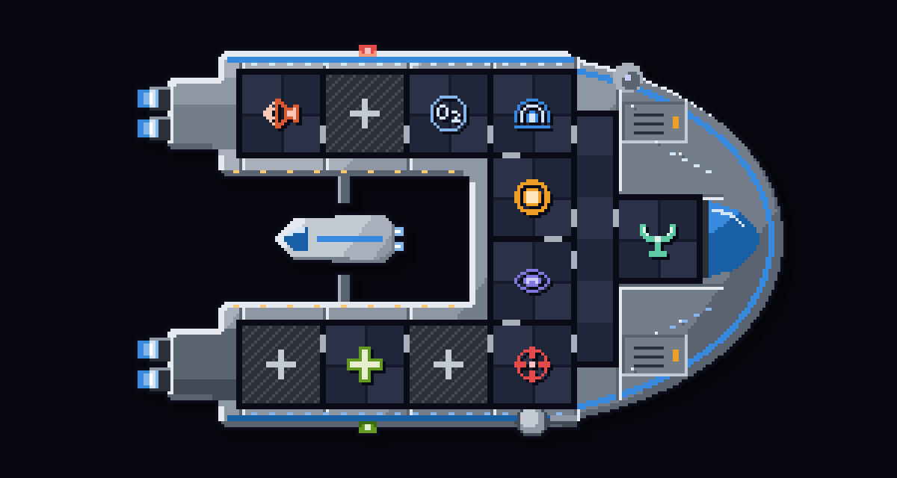

# Mensch Frachter

C-Form, grau-blau, Öffnung zum Heck mit Shuttlebucht. Bug rechts.

- Grafik: `art/export/1x/ships/mensch_frachter.png` (280 × 140 px)
- Raster: 11 × 8 Kacheln à 14 px. Ursprung = obere linke Ecke des Raumrasters bei Pixel (70, 14).
- Erweiterungsräume: 3 · Start-Modul: keins

## Räume

Koordinaten in Kacheln (Spalte, Zeile) der oberen linken Ecke. Jeder Raum belegt 2 × 2 Kacheln.

| Raum | Position | Lage |
|---|---|---|
| Antrieb | (0, 0) | oberer Arm, Heck |
| Erweiterung 1 | (2, 0) | oberer Arm |
| Lebenserhaltung | (4, 0) | oberer Arm |
| Schilde | (6, 0) | oberer Arm, vorn |
| Reaktor | (6, 2) | Mittelteil |
| Sensoren | (6, 4) | Mittelteil |
| Waffen | (6, 6) | unterer Arm, vorn |
| Erweiterung 3 | (4, 6) | unterer Arm |
| Medbay | (2, 6) | unterer Arm |
| Erweiterung 2 | (0, 6) | unterer Arm, Heck |
| Cockpit | (9, 3) | Nase, mit Kanzel |
| Korridor | (8, 1)–(8, 6), 1 × 6 | verbindet alle Bugräume |

Luftschleusen: oben in Erweiterung 1 (Kachel 3, 0) und unten in Erweiterung 2 (Kachel 1, 7). Beide liegen in Außenräumen am Heck, weit weg von Cockpit und Medbay, damit ein Ablassen die Brücke nicht gefährdet.

Shuttlebucht: Spalten 0–5, Zeilen 2–5, außerhalb des Druckrumpfs, Shuttle in Klammern.

## Türen

Zwischen allen benachbarten Räumen eines Arms, entlang der Bugsäule (Schilde ↔ Reaktor ↔ Sensoren ↔ Waffen), vom Korridor zu Schilde, Reaktor, Sensoren und Waffen sowie vom Korridor ins Cockpit. Die genauen Koordinaten stehen in `DOORS` in `tools/artgen/ship_human_freighter.py`.

## Außenausstattung

- 2 Triebwerksgondeln mit je 2 Düsen an den Armenden
- Geschützturm am unteren Rumpf beim Waffenraum
- Sensorschüssel oben am Bug
- 2 Frachtluken mit Lüftungsgittern am Bug
- Blaue Kennstreifen und Fensterreihen an den Armen
