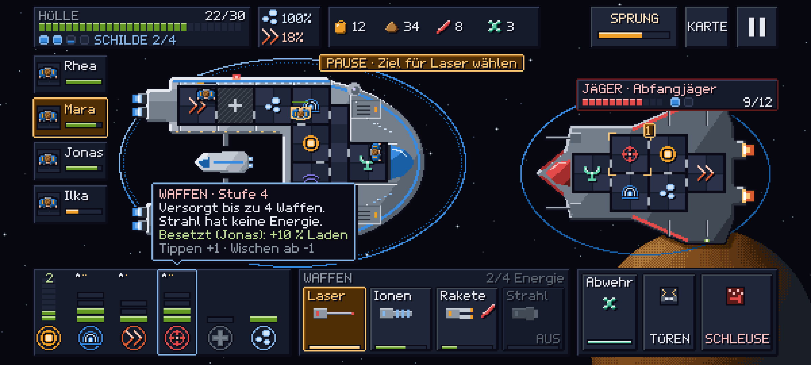

# UI-Layout für Handy-Querformat

Referenzgerät: **2400 × 1080 px (20:9)**, Querformat, ca. 2,625 px/dp (≈ 914 × 411 dp).

Prüfbild mit Safe Areas (rot) und Trefferflächen (grün ≥ 48 dp, orange darunter): [kampf_hud_raster_2400x1080.png](../art/ui/kampf_hud_raster_2400x1080.png)

Erzeugt mit `python3 tools/artgen/ui_kampf.py`. Das Skript setzt die Sprites aus `art/export/1x` voraus (`build.py`) und prüft, dass jedes Pixel aus der Palette stammt.

## Raster

| Größe | Wert | Begründung |
|---|---|---|
| Logische Auflösung | **600 × 270** | 2400 × 1080 geteilt durch 4 |
| Pixelfaktor | **×4**, nur ganzzahlig | Pixel-Art bleibt scharf, kein Flimmern |
| 1 logischer px | 4 px ≈ 1,52 dp | |
| Mindest-Trefferfläche | **32 × 32** logisch = 128 px ≈ 49 dp | Android-Richtwert 48 dp |
| Safe Area links/rechts | 24 logisch (96 px) | Kamera-Aussparung; wechselt beim Drehen die Seite |
| Safe Area unten | 6 logisch (24 px) | Gestenleiste |
| Safe Area oben | 4 logisch | Statusleiste ist im Spiel ausgeblendet |

## Schrift

Eigene Pixelschrift (`tools/artgen/pixelfont.py`): Versalhöhe 7 px, x-Höhe 5 px, Unterlängen 2 px, Zeilenabstand 10 px. Bei ×4 entspricht die Versalhöhe 28 px, also etwa einer 15-sp-Schrift. Text unter dieser Größe gibt es nicht. Labels stehen in Grau `#8E97A4`, Werte in `#E6EAF0`. Text über dem Weltraum bekommt eine 1-px-Schattenkante unten rechts.

## Bausteine

- **Panel:** Fläche `#161B2B`, 1-px-Rand `#0A0B16` mit abgeschnittenen Eckpixeln, helle Innenkante oben links (`#363E58`). Das Licht kommt wie bei den Sprites von oben links. Es gibt keine abgeschrägten Kanten und keinen Leuchtrand.
- **Knopf:** wie ein Panel, nur heller (`#20263A`/`#424A56`). Ist er aktiv oder ausgewählt, wird er dunkelorange mit gelbem Rand `#FAC775`. Gelb markiert durchgehend Auswahl, Bereitschaft und Ziel.
- **Balken:** schwarzer Rahmen, 1 px Lichtkante. Grün steht für Ladung bzw. Energie, Gelb für bereit, Orange und Rot für Warnungen.
- **Hülle:** 30 Segmente, die Farbe wechselt je nach Stand zwischen Grün, Orange und Rot.
- **Schildbarrieren:** abgerundete Plättchen, die sich beim Laden von unten füllen.
- **Systemplakette:** Ring in der Systemfarbe mit Raumsymbol (12 px); ohne Energie grau.
- **Tooltip:** öffnet sich per langem Tippen. Dunkle Fläche, hellblauer Rand, Zeiger zum Element. Er erklärt Regel, Stufe, Besetzungsbonus und Geste.
- **Auto-Pause-Hinweis:** gelbes Band oben in der Mitte, solange ein Befehl auf ein Ziel wartet.
- **Ziel:** gelbe Eckwinkel um den Raum, daneben die Nummer der Waffe.
- **Auswahl der Crew:** Kontur der Figur gelb statt dunkel, die Karte in der Liste ebenfalls gelb.

Die Probe zeigt mehrere Zustände gleichzeitig (Ziel wählen, Tooltip, Auswahl). Im Spiel kommen sie nicht alle zugleich vor.

## Andere Seitenverhältnisse (Godot 4)

Empfohlene Projekteinstellungen:

- `display/window/size/viewport_width = 540`, `viewport_height = 270` (Mindestbreite, 2:1)
- `display/window/stretch/mode = viewport`, `aspect = expand`, `scale_mode = integer`
- HUD-Gruppen an den Rändern verankern. Die Schiffe stehen in der Mitte; die Lücke zwischen ihnen wächst oder schrumpft.
- Safe Area zur Laufzeit aus `DisplayServer.get_display_safe_area()` lesen statt fest 24 px.

| Gerät | Faktor | Logische Fläche |
|---|---|---|
| 2400 × 1080 (20:9) | 4 | 600 × 270 |
| 2340 × 1080 (19,5:9) | 4 | 585 × 270 |
| 2160 × 1080 (18:9) | 4 | 540 × 270 |
| 1920 × 1080 (16:9) | 3 | 640 × 360 |
| 2560 × 1600 (Tablet 16:10) | 4 | 640 × 400 |

Bei 16:9 springt der Faktor auf 3. Dann wird alles 25 % kleiner, und Räume landen bei etwa 32 dp. Abhilfe: die Schiffsansicht dort größer skalieren als das HUD oder eine Zoomstufe anbieten.

## Offene Punkte

- **Räume sind 28 px groß, das sind ≈ 43 dp, also knapp unter 48 dp.** Vorschlag: Ein Tippen trifft den nächstgelegenen Raum, ohne dass der Finger exakt den Raum treffen muss, und langes Tippen vergrößert die Schiffsansicht. Die Alternative wäre ein Pixelfaktor ×5 nur für die Schiffe; dann passen aber eigenes und gegnerisches Schiff nicht mehr nebeneinander.
- Das Gegnerschiff (`tools/artgen/ship_hunter.py`, Abfangjäger der Jägerflotte) ist ein Platzhalter. Antrieb- und Cockpitsymbol zeigen noch nach rechts.
- Die Waffenbilder sind einfache Silhouetten. Laut Referenz-Notizen sollen es 48 × 32 px große Gegenstandsbilder werden; die passen in die 47 px breiten Karten nur ohne Rand.
- Das GDD nennt an anderer Stelle „drei große Daumen-Buttons unten (Pause, Waffen, Sprung)“. Die Probe folgt dagegen dem detaillierten Abschnitt zum Kampf-HUD: Pause und Sprung oben rechts, Waffen unten in der Mitte. Eine der beiden Stellen sollte angepasst werden.
